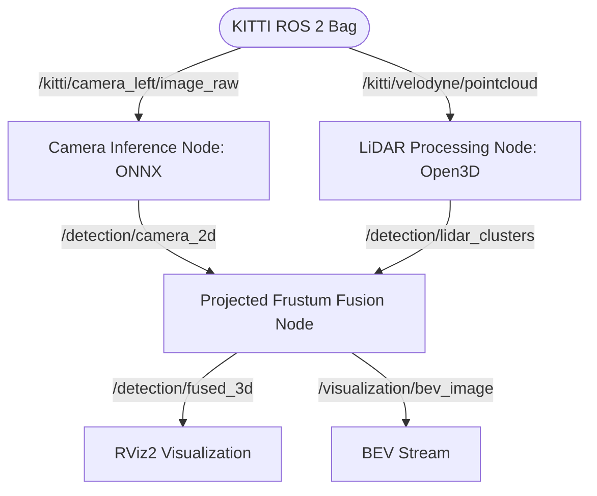

# KITTI 3D Perception Pipeline

A ROS 2 Jazzy pipeline for KITTI 3D perception, combining LiDAR geometry with camera detections through calibrated projection and geometric frustum fusion.

## Pipeline Demonstration


---

## Tech Stack

**Python 3.12 · ROS 2 Jazzy · Open3D · OpenCV · PyTorch · ONNX Runtime · CUDA · KITTI · Sensor Fusion · Pixi**

**Robotics Framework & Core Language:** `ROS 2 Jazzy` and `Python 3.12`, with native node composition, simulation-clock synchronization, and optimized execution loops.
- **Deep Learning Inference:** `ONNX Runtime` with the CUDA execution provider and explicit I/O binding for real-time 2D object detection on the left KITTI camera stream.
- **Point Cloud & Image Processing:** `Open3D`, `OpenCV`, and `NumPy` for ground-plane removal (RANSAC), spatial ROI filtering, GPU-accelerated DBSCAN clustering, and BEV (Bird's-Eye View) rendering.
- **Sensor Fusion Architecture:** Vectorized parallel matrix broadcasting with `PyTorch` CUDA tensors associates 2D camera detections with projected 3D LiDAR cluster centroids using factory-calibrated rigid transformation matrices.
- **Determinism & Reproducibility:** A 100% reproducible environment powered by `Pixi` (the RoboStack conda ecosystem), enabling installation without system-level dependencies.


---

## System Architecture



The data flow spans across four decoupled nodes. Camera and LiDAR detections converge at the fusion layer; the Bird's-Eye-View (BEV) visualizer visualizes the latest processed outputs asynchronously.

---

## 📊 Performance & Benchmarking

The end-to-end pipeline has been rigorously profiled and automated across multiple consecutive evaluation runs to guarantee deterministic execution metrics.

### Hardware Environment
- **CPU:** 12th Gen Intel(R) Core(TM) i5-12400 (6 Cores / 12 Threads)
- **GPU:** NVIDIA GeForce RTX 4060
- **Dataset / Workload:** KITTI Sync Bag (`2011_09_29_drive_0071_sync`, ~5.0 GB)

### End-to-End Execution Profile
Empirical metrics recorded across 3 consecutive automated evaluation runs at standard 1.0x native playback frequency (10 Hz). 

*Note: Latency values represent the median of each completed run's mean execution time (not the p50 value of the raw frame-by-frame distribution).*

| Pipeline Component | Underlying Operations / Framework | Performance Metric (Median of Means) | Target Bound |
| :--- | :--- | :--- | :--- |
| **LiDAR Processing** | NumPy ROI Filter + **Open3D GPU CUDA RANSAC & DBSCAN** | **31.45 ms** (Total Callback) | < 100.0 ms (10Hz) |
| **Camera Inference** | **ONNX Runtime (CUDA Execution Provider)** | **4.89 ms** (Pure Inference) | < 33.3 ms (30Hz) |
| **Geometric Fusion** | Association & Extrinsic PyTorch Broadcasting | **2.67 ms** (Compute Interval) | < 10.0 ms |
| **BEV Visualization** | Asynchronous Bird's-Eye-View Canvas Render | **2.78 ms** (Total Callback) | < 20.0 ms |

### Key Bottleneck Analysis
- **GPU CUDA DBSCAN (3D Spatial Clustering):** **20.25 ms** (median run mean). Represents the primary processing loop footprint, showing an exceptionally tight variance across the entire evaluation track.
- **Total Camera Callback Overhead:** **11.31 ms**. While pure ONNX CUDA inference requires only 4.89 ms, the remaining overhead is bound to CPU-side image preprocessing, layout restructuring to NCHW, GPU-CPU memory transfer, and OpenCV Non-Maximum Suppression (NMS).
- **Total Fusion Callback:** **3.46 ms**. Maintained via an optimized `ApproximateTimeSynchronizer` queue layout.

### Resource Utilization Summary
- **Memory Footprint:** Peak VRAM consumption stabilized at **~1435 MiB**.
- **Hardware Load:** Device-wide GPU utilization maintained a lean **10.0% mean / 15.0% peak**, leaving substantial headroom for additional tracking and control modules.

---

## ⚙️ Requirements & Environment Setup

- [Pixi](https://pixi.sh) (Modern package management tool)
- Linux x86-64 with an NVIDIA GPU and compatible drivers (CUDA 12.9 workflow).
- A KITTI ROS 2 bag. The default launch expects `2011_09_29_drive_0071_sync/` in the repository root.

The Pixi environment fully wraps ROS 2 Jazzy and all required system/Python dependencies cleanly in user space, ensuring cross-machine reproducibility.

## 👁️ Camera Model & ONNX Serialization

The camera node uses YOLOv8n pretrained on COCO; it is not fine-tuned on KITTI. The node resizes the left camera image to `1248 x 384` and passes a float32 NCHW tensor.

| Property | Value |
| :--- | :--- |
| Model | `ros2_ws/src/kitti_r1_perception/torch_home/yolov8n.onnx` |
| Runtime input | `(1, 3, 384, 1248)` |
| Runtime output | `(1, 84, 9216)` (`output0`) |
| ONNX graph | Dynamic spatial axes; opset 20 |
| Export tooling | Ultralytics 8.4.104; PyTorch 2.10.0 |
| SHA-256, ONNX | `b349972be7113091a720bdf0d46d65729ed93483df75c45349beffe9f6abde39` |
| SHA-256, source weights | `f59b3d833e2ff32e194b5bb8e08d211dc7c5bdf144b90d2c8412c47ccfc83b36` |

The repository includes both model files. The Quick Start explains verification and optional re-export. The ONNX metadata identifies the model license as AGPL-3.0; review it before redistribution or commercial use.

## Quick Start

Run from the repository root on Linux with Pixi and a compatible NVIDIA driver. KITTI data is subject to a non-commercial license; review its terms before use.

1. **Install dependencies**

   ```bash
   pixi install
   ```

2. **Download and extract the KITTI sequence**

   ```bash
   chmod +x raw_data_downloader.sh
   ./raw_data_downloader.sh
   ```

   Also download and extract the `2011_09_26` calibration archive containing `calib_cam_to_cam.txt` and `calib_velo_to_cam.txt`.

3. **Convert the raw sequence to an MCAP bag**

   At the bottom of `mcap_converter/kitti_to_mcap.py`, set `KITTI_SEQUENCE` to the extracted `2011_09_29_drive_0071_sync` directory, `KITTI_CALIB_DIR` to the calibration directory, and `BAG_OUTPUT` to `2011_09_29_drive_0071_sync` in the repository root. Then run:

   ```bash
   pixi run python mcap_converter/kitti_to_mcap.py
   ```

   The converter deletes and recreates the configured output path.

4. **Verify the camera model**

   The repository includes the ONNX model and source weights. Check their hashes against the [Camera Model](#camera-model) table:

   ```bash
   sha256sum \
     ros2_ws/src/kitti_r1_perception/torch_home/yolov8n.onnx \
     ros2_ws/src/kitti_r1_perception/torch_home/yolov8n.pt
   ```

   To re-export, install Ultralytics `8.4.104` in an isolated Python environment and run `torch_home/export.py` from that directory. The script downloads the official weights if they are missing.

5. **Build and launch**

   ```bash
   pixi run run-pipeline
   ```

   This validates the GPU environment, builds the ROS 2 workspace, and launches using the default bag path `2011_09_29_drive_0071_sync`.

## Customizing Playback

To run with a different bag or change launch parameters:

```bash
# Explicit workspace compilation
pixi run colcon build --symlink-install

# Execution with custom ROS 2 parameters
pixi run bash -c 'source install/setup.bash && ros2 launch kitti_r1_perception myperception.launch.py bag_path:=/absolute/path/to/bag'
```

The launch file accepts parameters such as `play_rate`, `playback_delay`, and clustering thresholds. See [`myperception.launch.py`](ros2_ws/src/kitti_r1_perception/launch/myperception.launch.py) for details.

---

## 📡 ROS 2 Topic Interface

### Subscribed Topics (Inputs)
- `/kitti/camera_left/image_raw` (`sensor_msgs/msg/Image`)
- `/kitti/velodyne/pointcloud` (`sensor_msgs/msg/PointCloud2`)
*Note: The pipeline bypasses the ROS 2 TF framework entirely to eliminate CPU-bound transformation lookup latencies, utilizing parameterized rigid calibration matrices directly within GPU VRAM.*

### Published Topics (Outputs)
- `/detection/camera_2d` — 2D Bounding Boxes with class probabilities.
- `/detection/lidar_clusters` — Unassociated spatial clusters.
- `/lidar/points_no_ground` — Downsampled, filtered raw point cloud.
- `/detection/fused_3d` — **Fused 3D Bounding Boxes combining LiDAR spatial geometry with YOLO class probabilities.**
- `/visualization/bev_image` — Real-time Bird's-Eye-View projection canvas.

---

## 🔬 Limitations & Error Analysis (Edge Cases)

- **Spatial & Class Ambiguity (e.g., Minibus vs. Motorcycle):** Since 3D bounding box estimation relies on geometric frustum association and DBSCAN clustering, extreme spatial occlusion or tightly packed entities can cause cluster bleeding. For instance, a motorcycle adjacent to a larger vehicle might temporarily combine into a single spatial heuristic cluster.
- **Absence of Temporal Tracking & Heading:** The current fusion node operates purely on a frame-by-frame basis without temporal tracking (e.g., Kalman Filters). Consequently, object orientation (yaw headings) and velocity vectors are not yet estimated or accumulated across time.
- **Temporal Ghosting on BEV Cache:** Because the Fusion node conditionally omits publishing during empty cycles to reduce stream overhead, the asynchronous BEV visualizer retains the last valid detection pointer. In dynamic ego-motion scenarios, this can cause transient "ghost tracks" until the cache is explicitly overwritten by a new synchronized camera-LiDAR pair.

### Future Roadmap
- [ ] Integrating a multi-object temporal tracker (Extended Kalman Filter / SORT) to compute object heading, velocity vectors, and handle transient occlusions.
- [ ] Implementing dynamic Odometry Compensation using KITTI OXTS (GPS/IMU) telemetry data to establish stable global coordinate tracking.
- [ ] Transitioning the core Fusion node to native ROS 2 Lifecycle C++ Components to achieve zero-copy data transport.

---

## 📖 Extended Documentation

- [Technical Deep-Dive & Architecture Report](TECHNICAL_REPORT.md)
- [Developer & Contribution Guide](DEVELOPMENT.md)
- [Perception Package Implementation Details](ros2_ws/src/kitti_r1_perception/README.md)
- [High-Throughput KITTI-to-MCAP Converter](mcap_converter/README.md)
- [Sensor Frame Calibration & Mathematics Work](CompVisionKnowHow.md)
