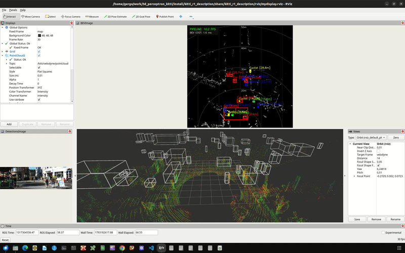

# KITTI 3D Perception Pipeline

A production-ready ROS 2 Jazzy application that integrates camera and LiDAR data using 2D-projected geometric Frustum Fusion, low-latency deep learning 2D inference, and rigid calibration-matrix projections.

## 👁️ Pipeline Demonstration



---

## 🛠️ Tech Stack & Key Features

**Python 3.12 · ROS 2 Jazzy · Open3D · OpenCV · PyTorch · ONNX Runtime · CUDA · KITTI · Sensor Fusion · Pixi**

- **Robotics Framework & Core Language:** `ROS 2 Jazzy` and `Python 3.12`, with native node composition, simulation-clock synchronization, and optimized execution loops.
- **Deep Learning Inference:** `ONNX Runtime` with the CUDA execution provider and explicit I/O binding for real-time 2D object detection on the left KITTI camera stream.
- **Point Cloud & Image Processing:** `Open3D`, `OpenCV`, and `NumPy` for ground-plane removal (RANSAC), spatial ROI filtering, GPU-accelerated DBSCAN clustering, and BEV (Bird's-Eye View) rendering.
- **Sensor Fusion Architecture:** Vectorized parallel matrix broadcasting with `PyTorch` CUDA tensors associates 2D camera detections with projected 3D LiDAR cluster centroids using factory-calibrated rigid transformation matrices.
- **Determinism & Reproducibility:** A 100% reproducible environment powered by `Pixi` (the RoboStack conda ecosystem), enabling installation without system-level dependencies.


---

## 📐 System Architecture


The data flow spans across four decoupled nodes. Camera and LiDAR detections converge at the fusion layer; the Bird's-Eye-View (BEV) visualizer visualizes the latest processed outputs asynchronously.

---

## 📊 Performance & Benchmarking

The end-to-end pipeline has been rigorously profiled and automated across multiple consecutive evaluation runs to guarantee deterministic execution metrics.

### Hardware Environment
- **CPU:** 12th Gen Intel(R) Core(TM) i5-12400 (6 Cores / 12 Threads)
- **GPU:** NVIDIA GeForce RTX 4060
- **Dataset / Workload:** KITTI Sync Bag (`2011_09_29_drive_0071_sync`, ~5.0 GB)

### End-to-End Execution Profile
Empirical metrics recorded across 3 consecutive automated evaluation runs at standard 1.0x native playback frequency (10 Hz). 

*Note: Latency values represent the median of each completed run's mean execution time (not the p50 value of the raw frame-by-frame distribution).*

| Pipeline Component | Underlying Operations / Framework | Performance Metric (Median of Means) | Target Bound |
| :--- | :--- | :--- | :--- |
| **LiDAR Processing** | NumPy ROI Filter + **Open3D GPU CUDA RANSAC & DBSCAN** | **31.45 ms** (Total Callback) | < 100.0 ms (10Hz) |
| **Camera Inference** | **ONNX Runtime (CUDA Execution Provider)** | **4.89 ms** (Pure Inference) | < 33.3 ms (30Hz) |
| **Geometric Fusion** | Association & Extrinsic PyTorch Broadcasting | **2.67 ms** (Compute Interval) | < 10.0 ms |
| **BEV Visualization** | Asynchronous Bird's-Eye-View Canvas Render | **2.78 ms** (Total Callback) | < 20.0 ms |

### Key Bottleneck Analysis
- **GPU CUDA DBSCAN (3D Spatial Clustering):** **20.25 ms** (median run mean). Represents the primary processing loop footprint, showing an exceptionally tight variance across the entire evaluation track.
- **Total Camera Callback Overhead:** **11.31 ms**. While pure ONNX CUDA inference requires only 4.89 ms, the remaining overhead is bound to CPU-side image preprocessing, layout restructuring to NCHW, GPU-CPU memory transfer, and OpenCV Non-Maximum Suppression (NMS).
- **Total Fusion Callback:** **3.46 ms**. Maintained via an optimized `ApproximateTimeSynchronizer` queue layout.

### Resource Utilization Summary
- **Memory Footprint:** Peak VRAM consumption stabilized at **~1435 MiB**.
- **Hardware Load:** Device-wide GPU utilization maintained a lean **10.0% mean / 15.0% peak**, leaving substantial headroom for additional tracking and control modules.

---

## ⚙️ Requirements & Environment Setup

- [Pixi](https://pixi.sh) (Modern package management tool)
- Linux x86-64 with an NVIDIA GPU and compatible drivers (CUDA 12.9 workflow).
- A KITTI ROS 2 bag. The default launch expects `2011_09_29_drive_0071_sync/` in the repository root.

The Pixi environment fully wraps ROS 2 Jazzy and all required system/Python dependencies cleanly in user space, ensuring cross-machine reproducibility.

## 👁️ Camera Model & ONNX Serialization

The camera perception subsystem loads a hardware-optimized **Ultralytics YOLOv8n** network topology pretrained on the COCO dataset. Left-side KITTI raw color channels are ingested, dynamically resized, and normalized inside the execution loop to satisfy the network's strict static input tensor graph contract without introducing asynchronous backlog latency.

### 📐 Graph Specifications & Verification Interface

| **Execution Feature / Layer Boundary** | **Production Specification / Target Value** |
| :--- | :--- |
| **Runtime Model File Path** | `ros2_ws/src/kitti_r1_perception/torch_home/yolov8n.onnx` |
| **Input Node Identifier & Layout** | `images`, Float32 Type, Standard `NCHW` Data Order |
| **Explicit Graph Input Shape** | `(1, 3, 384, 1248)` *(Explicit Height: 384, Explicit Width: 1248)* |
| **Output Node Identifier & Shape** | `output0`, Float32 Type, Shape: `(1, 84, 9216)` |
| **Decoded Internal Matrix Channels** | 4 Bounding Box Regression Coordinates + 80 COCO Class Scores |
| **Target Compilation Toolchain** | Ultralytics `8.4.104` · PyTorch `2.10.0` · ONNX Opset `14` |
| **SHA-256 Digest (`yolov8n.onnx`)** | `b349972be7113091a720bdf0d46d65729ed93483df75c45349beffe9f6abde39` |
| **SHA-256 Digest (`yolov8n.pt` source)** | `f59b3d833e2ff32e194b5bb8e08d211dc7c5bdf144b90d2c8412c47ccfc83b36` |

To enforce deterministic execution bounds and safeguard the `CUDAExecutionProvider` layout structures against spatial runtime crashes, confirm the cryptographic checksums of the network weights files from your active repository root workspace:

```bash
sha256sum \
  ros2_ws/src/kitti_r1_perception/torch_home/yolov8n.onnx \
  ros2_ws/src/kitti_r1_perception/torch_home/yolov8n.pt
```

---

### Compiling the Model (KITTI-Optimized Export)

The repository relies on the streamlined, production-ready `ros2_ws/src/kitti_r1_perception/torch_home/export.py` script as the official toolchain to compile the model. This minimal configuration bypasses verbose parsing, hardcoded fallback bounds, and explicitly maps the required tensor profiles.

To execute the compilation pipeline, run the script from its native directory:

```bash
cd ros2_ws/src/kitti_r1_perception/torch_home && python3 export.py
```

The underlying execution logic inside `export.py` enforces the exact aspect ratio mapping and dynamic axes required by the pipeline:

```python
from ultralytics import YOLO

# Load baseline PyTorch weights layout into host memory
model = YOLO('yolov8n.pt')

# Compile tensor graph utilizing explicit KITTI bounds and structural optimizations
model.export(
    format='onnx',
    imgsz=, # Multiples of 32 mapped to exact [Height, Width] input criteria
    dynamic=True,      # Injects dynamic execution axes to handle minor spatial frame shifts
    simplify=True,     # Fuses redundant kernel operations to minimize outer GPU-CPU latency
    opset=14           # Maximum operational compatibility bound for ONNX Runtime 1.18+ Providers
)
```

> ⚠️ **Critical Execution Note:** Do not execute legacy or decoupled export configurations that force symmetric `640x640` configurations or disable dynamic axes (`dynamic=False`). Mismatched input layer profiles will trigger strict shape validation faults inside the `CameraDetectorNode` subscriber callback layer, rendering the node unable to process incoming KITTI streams.
---

---

## 📅 Data Acquisition & Preparation

The pipeline requires the synchronized and rectified raw KITTI data converted into ROS 2 MCAP or Bag format. The default launch system expects the `2011_09_29_drive_0071_sync` dataset.

### 1. License Agreement
The KITTI dataset is strictly released under a **Creative Commons Attribution-NonCommercial-ShareAlike 3.0** license. By downloading the data, you agree that it will be used solely for non-commercial research purposes.

### 2. Download and Extraction
Automate the raw data download using the `raw_data_downloader.sh` script provided in the repository. This will download the Velodyne point clouds, camera images, and calibration matrices:

```bash
# Ensure the script is executable (if you cloned the repo and the bit is not set)
chmod +x raw_data_downloader.sh

# Execute the automated downloader script
./raw_data_downloader.sh
```

Alternatively, you can manually acquire the archives from the [KITTI Raw Data Repository](https://www.cvlibs.net/datasets/kitti/raw_data.php):
To guarantee data integrity before processing, verify the MD5 checksums of the downloaded zip files.
Run the following command in the directory where the downloaded zip file is located:
- **Total Download Size:** ~4.1 GB (Compressed) / ~5.0 GB (Extracted)

To guarantee data integrity after manual downloads or custom mirrors, always generate and verify the local checksum against your team's reference hash:
```bash
# Generate MD5 checksum to verify archive integrity
md5sum 2011_09_29_drive_0071_sync.zip
```

### 3. Converting to ROS 2 MCAP Format
Once extracted, use the internal high-throughput converter to transform the raw KITTI files into a high-performance MCAP storage file for ROS 2 Jazzy:

> **Note:** The typical workflow is to first run `./raw_data_downloader.sh` to download and extract the KITTI data, then run `pixi run python mcap_converter/kitti_to_mcap.py` to convert the data into MCAP format. Both steps are required before launching the pipeline.

```bash
# Navigate to and run the high-throughput converter
pixi run python mcap_converter/kitti_to_mcap.py
```

### 4. Automated Data Validation & Error Handling
The pipeline launch script (`myperception.launch.py`) features defensive asset validation. If the required bag or MCAP file is missing from the configured path, the launch sequence will gracefully terminate immediately to prevent continuous node crashes.

### Expected Failure Output

Example output:
```text
none
```

## 🚀 Execution & Run Guide

From the repository root, install dependencies and execute the launch system using a single toolchain:

```bash
# Install and cache dependencies in an isolated workspace
pixi install

# Run the complete end-to-end perception pipeline with RViz visualization
pixi run run-pipeline
```

The automation task verifies your local GPU architecture, builds the isolated ROS workspace, brings up all pipeline perception nodes alongside RViz2, and plays back the default data bag using the simulation clock. Logs are preserved in `pipeline_session.log`.

### Customizing Playback & Parameters

To build manually and run against custom bags or change runtime parameters:

```bash
# Explicit workspace compilation
pixi run colcon build --symlink-install

# Execution with custom ROS 2 parameters
pixi run bash -c 'source install/setup.bash && ros2 launch kitti_r1_perception myperception.launch.py bag_path:=/absolute/path/to/bag'
```

*Note: The main launch file accepts tuning parameters such as `play_rate`, `playback_delay`, and specific clustering thresholds. See [`myperception.launch.py`](ros2_ws/src/kitti_r1_perception/launch/myperception.launch.py) for the complete interface configuration.*

---

## 📡 ROS 2 Topic Interface

### Subscribed Topics (Inputs)
- `/kitti/camera_left/image_raw` (`sensor_msgs/msg/Image`)
- `/kitti/velodyne/pointcloud` (`sensor_msgs/msg/PointCloud2`)
*Note: The pipeline bypasses the ROS 2 TF framework entirely to eliminate CPU-bound transformation lookup latencies, utilizing parameterized rigid calibration matrices directly within GPU VRAM.*

### Published Topics (Outputs)
- `/detection/camera_2d` — 2D Bounding Boxes with class probabilities.
- `/detection/lidar_clusters` — Unassociated spatial clusters.
- `/lidar/points_no_ground` — Downsampled, filtered raw point cloud.
- `/detection/fused_3d` — **Fused 3D Bounding Boxes combining LiDAR spatial geometry with YOLO class probabilities.**
- `/visualization/bev_image` — Real-time Bird's-Eye-View projection canvas.

---

## 🔬 Limitations & Error Analysis (Edge Cases)

- **Spatial & Class Ambiguity (e.g., Minibus vs. Motorcycle):** Since 3D bounding box estimation relies on geometric frustum association and DBSCAN clustering, extreme spatial occlusion or tightly packed entities can cause cluster bleeding. For instance, a motorcycle adjacent to a larger vehicle might temporarily combine into a single spatial heuristic cluster.
- **Absence of Temporal Tracking & Heading:** The current fusion node operates purely on a frame-by-frame basis without temporal tracking (e.g., Kalman Filters). Consequently, object orientation (yaw headings) and velocity vectors are not yet estimated or accumulated across time.
- **Temporal Ghosting on BEV Cache:** Because the Fusion node conditionally omits publishing during empty cycles to reduce stream overhead, the asynchronous BEV visualizer retains the last valid detection pointer. In dynamic ego-motion scenarios, this can cause transient "ghost tracks" until the cache is explicitly overwritten by a new synchronized camera-LiDAR pair.

### Future Roadmap
- [ ] Integrating a multi-object temporal tracker (Extended Kalman Filter / SORT) to compute object heading, velocity vectors, and handle transient occlusions.
- [ ] Implementing dynamic Odometry Compensation using KITTI OXTS (GPS/IMU) telemetry data to establish stable global coordinate tracking.
- [ ] Transitioning the core Fusion node to native ROS 2 Lifecycle C++ Components to achieve zero-copy data transport.

---

## 📖 Extended Documentation

- [Technical Deep-Dive & Architecture Report](TECHNICAL_REPORT.md)
- [Developer & Contribution Guide](DEVELOPMENT.md)
- [Perception Package Implementation Details](ros2_ws/src/kitti_r1_perception/README.md)
- [High-Throughput KITTI-to-MCAP Converter](mcap_converter/README.md)
- [Sensor Frame Calibration & Mathematics Work](CompVisionKnowHow.md)
