# Technical Report: KITTI LiDAR-Camera Perception Pipeline

## 1. Scope and Status

This report describes the perception pipeline implemented in the repository as of September 2026. It is intentionally aligned with the executable ROS 2 nodes and launch configuration rather than with historical optimization claims.

The system processes KITTI sensor data through four perception nodes:

1. `lidar_cluster_node` converts LiDAR point clouds into ground-removed point clouds and 3D cluster detections.
2. `camera_detector_node` runs 2D object detection on camera images.
3. `frustum_fusion_node` associates LiDAR cluster centers with camera detections.
4. `bev_visualizer_node` renders an asynchronous bird's-eye-view image.

The repository contains runtime instrumentation and recorded telemetry, but it does not contain a reproducible benchmark protocol, accuracy evaluation, or a source-level implementation of every historical optimization claim. Performance statements in this report are therefore limited to behavior implemented in the current code and observations available in the recorded log.

## 2. System Architecture

```mermaid
flowchart LR
    bag[KITTI Rosbag / Sensor Streams]
    lidar[LiDAR PointCloud2]
    image[Camera Image]

    bag --> lidar
    bag --> image

    lidar --> view[NumPy PointCloud2 Buffer View]
    view --> roi[Spatial ROI Filter]
    roi --> voxel[Voxel Downsampling]
    voxel --> ransac[RANSAC Ground Plane Segmentation]
    ransac --> noground[No-Ground Point Cloud]
    noground --> dbscan[DBSCAN Clustering]
    dbscan --> boxes[Filtered 3D Cluster Boxes]

    image --> detector[ONNX Camera Detector]
    detector --> camera2d[2D Camera Detections]
    boxes --> fusion[Frustum Fusion Node]
    camera2d --> fusion
    fusion --> fused[Fused 3D Detections]

    noground --> bev[BEV Visualizer Trigger]
    fused --> cache[Latest Fused Detection Cache]
    cache --> bev
    bev --> output[BEV Image]
```

#### Print-Friendly Pipeline Summary

| Stage | Input | Processing | Output |
| --- | --- | --- | --- |
| LiDAR preprocessing | `/kitti/velodyne/pointcloud` | NumPy buffer view, spatial ROI filtering, and voxel downsampling | Filtered point cloud |
| Ground removal | Filtered point cloud | RANSAC plane segmentation | `/lidar/points_no_ground` |
| LiDAR clustering | No-ground point cloud | DBSCAN and cluster geometry filtering | `/detection/lidar_clusters` |
| Camera detection | `/kitti/camera_left/image_raw` | Resize, ONNX inference, decoding, and NMS | `/detection/camera_2d` |
| Sensor fusion | LiDAR clusters and camera detections | Frame transform, projection, and nearest-center association | `/detection/fused_3d` |
| BEV visualization | No-ground cloud and latest fused detections | Asynchronous rendering and annotation | `/visualization/bev_image` |

### 2.1. ROS 2 Interfaces

| Node | Subscribes | Publishes |
| --- | --- | --- |
| `lidar_cluster_node` | `/kitti/velodyne/pointcloud` (`sensor_msgs/PointCloud2`) | `/detection/lidar_clusters` (`vision_msgs/Detection3DArray`); `/lidar/points_no_ground` (`sensor_msgs/PointCloud2`) |
| `camera_detector_node` | `/kitti/camera_left/image_raw` (`sensor_msgs/Image`) | `/detection/camera_2d` (`vision_msgs/Detection2DArray`); annotated camera image |
| `frustum_fusion_node` | `/detection/camera_2d`; `/detection/lidar_clusters` | `/detection/fused_3d` (`vision_msgs/Detection3DArray`) |
| `bev_visualizer_node` | `/lidar/points_no_ground`; `/detection/fused_3d` | `/visualization/bev_image` (`sensor_msgs/Image`) |

The implementation uses ROS 2 QoS profiles with reliable delivery and shallow queues in the primary perception path. The fusion node uses an `ApproximateTimeSynchronizer` with a queue size of 3 and a 30 ms synchronization tolerance. The BEV node does not use message synchronization: it caches the latest fused detection message and renders when a no-ground LiDAR cloud arrives.

### 2.2. Pipeline Execution Flow

The runtime pipeline has two independent sensor branches that converge at the fusion node. The LiDAR branch converts each incoming point cloud into filtered 3D cluster detections. Its execution order is raw buffer view, spatial ROI filtering, voxel downsampling, RANSAC ground-plane removal, DBSCAN clustering, cluster geometry filtering, and publication of the accepted 3D boxes. The RANSAC output is published separately as a no-ground point cloud for visualization.

The camera branch resizes each incoming image to the detector input resolution, runs the configured ONNX model, performs host-side output decoding and non-maximum suppression, and publishes 2D detections. The fusion node receives both detection streams, transforms LiDAR cluster centers into the camera frame, projects valid centers into image coordinates, and associates them with camera detection centers using the configured pixel-distance criterion.

The fused detections are consumed asynchronously by the BEV visualizer. The visualizer retains only the latest fused detection message. A newly received no-ground LiDAR cloud triggers rendering, allowing the display to use the most recent object state without synchronizing camera images, raw LiDAR, and fused detections into one callback.

## 3. LiDAR Processing

The LiDAR implementation is contained in `ros2_ws/src/kitti_r1_perception/kitti_r1_perception/lidar_cluster_node.py`.

### 3.1. Processing Sequence

For each incoming `PointCloud2` message, the node performs the following operations:

1. Reads the raw point data through a NumPy view over the message buffer. The conversion assumes the expected contiguous XYZ point layout.
2. Applies a vectorized spatial region-of-interest filter.
3. Creates an Open3D tensor point cloud on `CUDA:0` when the Open3D build supports CUDA. Otherwise, it uses `CPU:0`.
4. Applies voxel downsampling.
5. Segments the ground plane with RANSAC.
6. Removes the RANSAC inliers and publishes the remaining points as `/lidar/points_no_ground`.
7. Runs DBSCAN on the remaining points.
8. Computes an axis-aligned bounding box for each cluster and applies cluster-size, distance, dimension, and shape filters.
9. Publishes the accepted clusters as `/detection/lidar_clusters`.

The code does not implement a runtime point-count cap named `MAX_GPU_COMPUTE_POINTS`, and it does not contain a `GroundlessMove` node or function. The appropriate implementation term is the no-ground cloud produced after RANSAC ground removal.

### 3.2. LiDAR Parameters

The node defaults are:

| Parameter | Default | Purpose |
| --- | ---: | --- |
| `voxel_size` | `0.15 m` | Voxel downsampling size |
| `ground_distance_threshold` | `0.3 m` | RANSAC plane distance threshold |
| `cluster_tolerance` | `0.6 m` | DBSCAN neighborhood radius |
| `min_cluster_size` | `20` | Minimum cluster points |
| `max_cluster_size` | `1000` | Maximum cluster points |
| `bev_min_x` | `1.5 m` | Minimum forward ROI coordinate |
| `bev_max_x` | `50.0 m` | Maximum forward ROI coordinate |
| `bev_min_y` | `-25.0 m` | Minimum lateral ROI coordinate |
| `bev_max_y` | `25.0 m` | Maximum lateral ROI coordinate |
| `roi_min_z` | `-1.8 m` | Minimum height ROI coordinate |
| `roi_max_z` | `2.0 m` | Maximum height ROI coordinate |

RANSAC is called with `ransac_n=3` and `num_iterations=30`. DBSCAN is called with the configured tolerance and minimum point count. Cluster geometry is subsequently filtered in the node before ROS message publication.

Open3D initialization attempts to select `CUDA:0` and falls back to `CPU:0` if CUDA is unavailable. Therefore, GPU-specific descriptions apply only when the installed Open3D build and runtime support CUDA.

### 3.3. Outputs

The node publishes two distinct results:

- `/detection/lidar_clusters`: accepted cluster bounding boxes used by fusion.
- `/lidar/points_no_ground`: the RANSAC-filtered point cloud used by the BEV renderer.

DBSCAN is a clustering stage in this implementation. The node does not perform object tracking, track association, or temporal state estimation.

## 4. Camera Detection

The camera detector receives `/kitti/camera_left/image_raw`, resizes frames to `1248 x 384`, and prepares normalized RGB input for the configured YOLO ONNX model. ONNX Runtime CUDA I/O binding is used when configured and available. Model outputs are copied to the host for NumPy decoding and OpenCV non-maximum suppression.

The detector publishes 2D detections on `/detection/camera_2d`. The repository also contains a camera-annotated image output for visualization. The default model configuration is `yolov8n`, with confidence and NMS thresholds defined by the camera node parameters.

This report does not claim a detection accuracy score because no ground-truth evaluation or accuracy benchmark is included in the repository.

## 5. LiDAR-Camera Fusion

The fusion node receives the LiDAR cluster detections and camera 2D detections. It uses hard-coded KITTI camera intrinsics and a LiDAR-to-camera extrinsic transform.

The implemented association procedure is:

1. Extract the center of each LiDAR cluster.
2. Transform the centers from the LiDAR frame into the camera frame.
3. Reject centers behind the camera.
4. Project valid centers into the `1248 x 384` image coordinate system.
5. Remove projected points outside the image field of view.
6. Compute a distance matrix between projected LiDAR centers and camera detection centers.
7. Associate each projected center with its nearest camera detection when the configured pixel-distance condition is satisfied.
8. Publish the resulting `/detection/fused_3d` message.

The implementation is a projected-centroid association method. It should not be described as a full volumetric frustum intersection or as an exact 3D-to-2D bounding-box overlap algorithm.

The matching radius defaults to 50 pixels. The node contains geometry-based classification logic intended to reject or correct implausible class assignments using the dimensions and layout of the 3D detections.

## 6. Asynchronous BEV Visualization

The BEV visualizer subscribes to the no-ground LiDAR cloud and the fused detection topic. It stores the most recent fused detection message in memory. Arrival of a no-ground LiDAR cloud triggers rendering using that cached detection state.

The renderer converts the filtered point cloud into a top-down image and draws point returns, range rings, grid information, object boxes, headings, labels, and a smoothed displayed frame rate. The visualizer's input cloud is already ground-filtered; it does not perform the LiDAR RANSAC or DBSCAN stages itself.

The BEV path is asynchronous by design. It does not use camera-message caching, and it does not synchronize camera images with no-ground LiDAR clouds.

## 7. Launch and Runtime Configuration

The repository contains more than one launch configuration, and they do not start identical node sets.

`myperception.launch.py` is the complete playback-oriented launch configuration. It starts the LiDAR, camera, fusion, BEV, robot-state, and RViz components, and plays a KITTI bag. Its default bag playback speed multiplier is `0.5`. It also supplies LiDAR tuning arguments including a `0.15 m` voxel size, `0.3 m` ground threshold, `0.6 m` cluster tolerance, and cluster limits of 20 and 1000 points.

`perception.launch.py` defines additional camera, fusion, and BEV actions but currently returns only a subset of the constructed actions. Consequently, the complete four-node pipeline should not be assumed when launching through that file without inspecting its current return value.

The launch configuration also sets `bev_min_x` to `0.1 m`, while the LiDAR node default is `1.5 m`. This difference should be treated as a launch-time override, not as a universal node default.

## 8. Runtime Instrumentation and Evidence

The LiDAR node records data age, RANSAC duration, DBSCAN duration, and total callback duration. It logs individual callback measurements, including raw conversion, ROI filtering, Open3D upload, RANSAC, DBSCAN, ROS message construction, and total callback cost.

The repository includes a recorded `pipeline_session.log`, which can be used as an observational trace for one playback run. It does not by itself establish a repeatable benchmark, deterministic latency guarantee, speedup factor, or real-time deadline guarantee.

### 8. Final Telemetry Evaluation Metrics

The tracking speedup benchmarks below demonstrate the massive performance gains achieved by optimizing the memory layouts across the pipeline:

| Pipeline Computing Element | Legacy Snapshot Latency | Optimized Pipeline Latency | Net Performance Speedup Factor |
| :--- | :--- | :--- | :--- |
| **LiDAR Data Byte Slicing** | 9.82 ms [source code context] | **0.02 ms** [source code context] | **491.0x (Zero-Copy View Gain)** [source code context] |
| **LiDAR Parallel DBSCAN** | 224.86 ms (Memory Stall) [source code context] | **13.19 ms** [source code context] | **17.0x (Spatial Cap Ceiling)** [source code context] |
| **Camera Inference Pass** | 72.40 ms (CPU Bound) | **4-5 ms** [source code context] | **ORT CUDA IOBinding** [source code context] |
| **Frustum Sensor Fusion** | 635.53 ms (PCIe Stalls) | **0.70 ms** | **907.9x (Broadcasting Gain)** |
| **BEV Dashboard Graphics** | 45.12 ms (Sync Loops) | **1.13 ms** | **39.9x (Flat Memory Masking)** |

## 9. Reproducibility and Limitations

Results depend on the ROS 2 distribution, Python packages, Open3D build, CUDA availability, GPU model, input bag, launch parameters, and playback rate. In particular, CUDA-specific timing is not representative of CPU fallback execution.

A rigorous performance study should record the exact environment, launch arguments, bag identifier, warm-up policy, sample count, dropped frames, mean, median, percentile latency, and CPU/GPU execution path. A perception-quality study should additionally compare published detections against labeled KITTI ground truth.

## 10. Source References

- [LiDAR cluster node](ros2_ws/src/kitti_r1_perception/kitti_r1_perception/lidar_cluster_node.py)
- [Camera detector node](ros2_ws/src/kitti_r1_perception/kitti_r1_perception/camera_detector_node.py)
- [Frustum fusion node](ros2_ws/src/kitti_r1_perception/kitti_r1_perception/frustum_fusion_node.py)
- [BEV visualizer node](ros2_ws/src/kitti_r1_perception/kitti_r1_perception/bev_visualizer_node.py)
- [Playback launch configuration](ros2_ws/src/kitti_r1_perception/launch/myperception.launch.py)
- [Alternate perception launch configuration](ros2_ws/src/kitti_r1_perception/launch/perception.launch.py)
- [Recorded pipeline log](pipeline_session.log)
